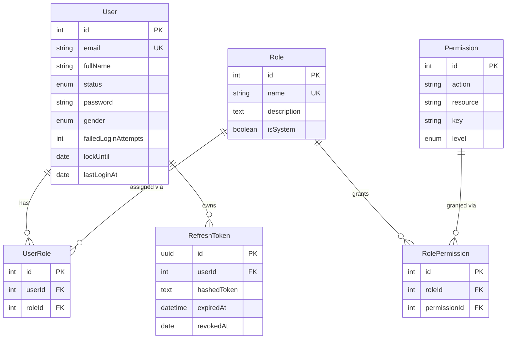
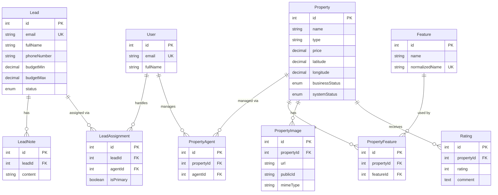
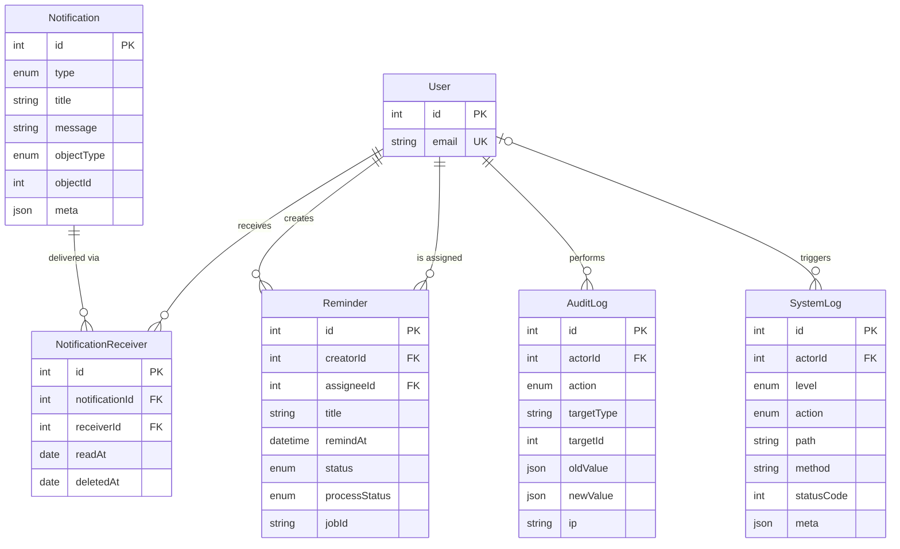

# FirstHome Backend

A real estate management backend built with **NestJS**, **TypeORM** and **MySQL**. It manages leads, properties and features, with JWT authentication, a dynamic RBAC system, Redis-backed rate limiting, background jobs, and structured logging.

**Live demo (Swagger UI):** https://bds-rlyi.onrender.com/docs

### Demo account

You can log in to the demo with the following account:

| Email                  | Password     |
| ---------------------- | ------------ |
| `superadmin@gmail.com` | `superadmin` |
| `admin1@gmail.com`     | `admin`      |
| `staff1@gmail.com`     | `staff`      |

> The demo is hosted on Render and may take a short while to wake up on the first request.

---

## Table of Contents

- [Features](#features)
- [Tech Stack](#tech-stack)
- [Architecture Highlights](#architecture-highlights)
- [Getting Started](#getting-started)
- [Environment Variables](#environment-variables)
- [Available Scripts](#available-scripts)
- [Testing](#testing)
- [API Documentation](#api-documentation)
- [Docker](#docker)
- [Deployment & CI/CD](#deployment--cicd)
- [Roadmap](#roadmap)

---

## Features

### Business modules

| Module           | Description                                                                                                              |
| ---------------- | ------------------------------------------------------------------------------------------------------------------------ |
| **Lead**         | Manage potential customers. Sub-modules: **Assignment** (assign leads to staff) and **Note** (notes attached to a lead). |
| **Property**     | Manage real estate listings. Sub-modules: **Agent**, **Image**, **Rating**, and more.                                    |
| **Feature**      | Manage property features that can be attached to properties.                                                             |
| **Notification** | Event-driven notifications using event listeners.                                                                        |

### Technical features

- **Authentication:** JWT access and refresh tokens, email-based account setup and password reset.
- **Authorization:** dynamic RBAC. Roles and permissions are stored in the database (`user`, `role`, `permission` and their join tables), so access rules can change without redeploying.
- **Rate limiting:** Redis-backed, configurable via environment variables.
- **Background jobs:** cron jobs with BullMQ (basic setup) for expired-token cleanup and reminders.
- **File uploads:** image storage with Cloudinary.
- **Email:** Nodemailer for account setup and password reset emails.
- **Logging:** separate **system log** and **audit log**.
- **API docs:** Swagger UI at `/docs`.
- **Testing:** unit and e2e tests for authentication and authorization.
- **Containerization:** Dockerfile and Docker Compose included.

## Tech Stack

- **Runtime / Language:** Node.js, TypeScript
- **Framework:** NestJS
- **Database:** MySQL with TypeORM
- **Cache / Queue:** Redis, BullMQ
- **Storage:** Cloudinary
- **Mail:** Nodemailer
- **Docs:** Swagger (`@nestjs/swagger`)
- **Testing:** Jest, Supertest, Testcontainer
- **DevOps:** Docker, Docker Compose, Render, basic CI/CD pipeline
- **Deployment:** Render, Aiven

## Architecture Highlights

### Dynamic RBAC

```   Permissions are not hard-coded into roles. They are stored in the database and linked through join tables (`users_roles`and`roles_permissions`):

```
User ──< UserRole >── Role ──< RolePermission >── Permission
```

- A **permission** is described by an `action`, a `resource`, a `key` and a `level`.
- A **role** can be flagged as `isSystem` to mark built-in roles.
- An authorization guard checks the permissions of the current user at request time, so an administrator can create roles and adjust permissions at runtime.

See [Database Design](#database-design) for the full schema.

### Logging

- **System log:** application events, warnings and errors.
- **Audit log:** records who did what and when on important resources.

### Background jobs

- **Token cleanup:** periodically removes expired tokens from the database.
- **Reminders:** scheduled reminders processed through a BullMQ queue.

## Database Design

The schema is split into three diagrams for readability. `User` appears in each one because most tables reference it. Only key columns are shown; see the entities in `backend/src/**/entities` for the full definitions.

### Access control and authentication



### Business domain



### Notifications, reminders and logs



### Notes

| Entity                 | Table name                | Notes                                                                                  |
| ---------------------- | ------------------------- | -------------------------------------------------------------------------------------- |
| `UserRole`             | `users_roles`             | Join table between users and roles (unique per pair).                                  |
| `RolePermission`       | `roles_permissions`       | Join table between roles and permissions (unique per pair).                            |
| `PropertyAgent`        | `properties_agents`       | Join table between properties and agents.                                              |
| `PropertyFeature`      | `properties_features`     | Join table between properties and features.                                            |
| `NotificationReceiver` | `notifications_receivers` | One notification can be delivered to many users, each with its own read/deleted state. |

- Join tables use their own `id` and a unique constraint on the pair of foreign keys, instead of a composite primary key.
- Most foreign keys use `ON DELETE RESTRICT`. The exception is `PropertyImage`, which is deleted together with its property (`CASCADE`).
- Refresh tokens are stored as hashes and can be revoked (`revokedAt`).
- `AuditLog` stores `oldValue` and `newValue` as JSON, so changes can be traced without a separate table per resource.
- `SystemLog` has a nullable `actorId` because some events (for example, unauthenticated requests) have no user.

## Getting Started

### Prerequisites

- Node.js 18 or later
- npm
- A running **MySQL** server
- A running **Redis** server
- A Cloudinary account (for image uploads)
- An email account usable with Nodemailer (for sending setup/reset emails)
- Docker (only required to run the e2e tests)

### Installation

```bash
# 1. Clone the repository
git clone https://github.com/tranductridung/bds
cd bds/backend

# 2. Install dependencies
npm install

# 3. Create your environment file
cp .env.example .env
# then fill in the values (see "Environment Variables")

# 4. Seed initial data
npm run seed

# 5. Start the development server
npm run start:dev
```

The API runs at `http://localhost:3000` and Swagger UI at `http://localhost:3000/docs`.

### Database and seeding

The project uses TypeORM with `synchronize` enabled, so tables are created and updated automatically from the entities. There are no migration files.

`npm run seed` populates the initial data required to use the system:

- Permissions and roles
- Super admin account (from `SUPERADMIN_EMAIL` and `SUPERADMIN_PASSWORD`)

## Environment Variables

Create a `.env` file in `backend/`. Never commit it to version control.

```dotenv
# App
NODE_ENV=development
TRUST_PROXY_HOPS=
SALT=
MAX_AGE=
MAX_TOKEN=

# MySQL
MYSQL_HOST=
MYSQL_PORT=3306
MYSQL_DATABASE=
MYSQL_USER=
MYSQL_USERNAME=
MYSQL_ROOT_PASSWORD=

# JWT / tokens
ACCESS_TOKEN=
ACCESS_TOKEN_EXPIRES=
REFRESH_TOKEN=
REFRESH_TOKEN_EXPIRES=
VERIFY_EMAIL_TOKEN=
VERIFY_EMAIL_TOKEN_EXPIRES=
SETUP_PASSWORD_TOKEN=
SETUP_PASSWORD_TOKEN_EXPIRES=

# Super admin (used by the seed script)
SUPERADMIN_EMAIL=
SUPERADMIN_PASSWORD=

# Email (Nodemailer)
EMAIL_USER=
EMAIL_PASSWORD=

# Cloudinary
CLOUDINARY_CLOUD_NAME=
CLOUDINARY_API_KEY=
CLOUDINARY_API_SECRET=

# Redis
REDIS_URL=
REDIS_HOST=localhost
REDIS_PORT=6379

# Rate limiting and queue
RATE_LIMIT_ENABLED=true
REQUEST_LIMIT_DEFAULT=
RATE_LIMIT_TTL_DEFAULT=
QUEUE_WINDOW_MS=
```

## Available Scripts

| Command              | Description                                         |
| -------------------- | --------------------------------------------------- |
| `npm run start:dev`  | Start in development mode with hot reload           |
| `npm run start`      | Start the application                               |
| `npm run start:prod` | Run the compiled build (`dist/main`)                |
| `npm run build`      | Compile the project                                 |
| `npm run seed`       | Seed initial data (permissions, roles, super admin) |
| `npm run test`       | Run unit tests                                      |
| `npm run test:cov`   | Run unit tests with coverage                        |
| `npm run test:e2e`   | Run end-to-end tests                                |
| `npm run lint`       | Lint and auto-fix the code                          |
| `npm run format`     | Format the code with Prettier                       |

## Testing

The project includes unit tests and e2e tests covering **authentication** and **authorization**.

```bash
# Unit tests
npm run test

# Unit tests with coverage
npm run test:cov

# End-to-end tests
npm run test:e2e
```

> **Note:** the e2e tests use [Testcontainers](https://testcontainers.com/) to start disposable **MySQL and Redis containers** automatically, so **Docker must be running** on your machine. No local MySQL/Redis setup or `.env` database settings are needed for e2e tests, and your development data is not affected. Unit tests do not require Docker.

## API Documentation

Swagger UI is available at `/docs`:

- Local: `http://localhost:3000/docs`
- Demo: https://bds-rlyi.onrender.com/docs

## Docker

A `Dockerfile` and `docker-compose.yml` are provided. The Compose file includes services for the app, MySQL and Redis, so the whole stack can be started without installing MySQL or Redis locally.

```bash
docker compose up --build
```

> Docker is not used for the production deployment (see below). Local development in this project is usually done with MySQL and Redis installed directly on the machine.

## Deployment & CI/CD

- **Hosting:** [Render](https://render.com) (the app is deployed directly, not as a Docker image).
- **Database:** managed MySQL on [Aiven](https://aiven.io)
- **CI:** [GitHub Actions](https://docs.github.com/en/actions) runs the automated tests on every push and pull request. The e2e tests start their own MySQL and Redis containers via Testcontainers.
- **CD:** Render builds and deploys the application automatically from the repository.

## Roadmap

- [ ] Document the main business flows (lead lifecycle, property listing)
- [ ] Replace `synchronize` with TypeORM migrations
- [ ] Expand test coverage to business modules
- [ ] Run lint (and build) in the CI pipeline before tests
