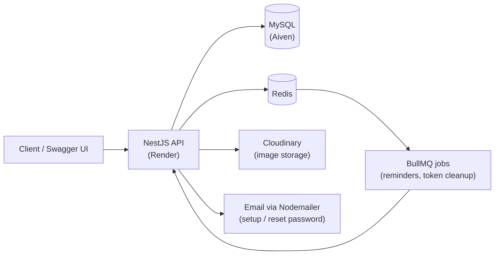
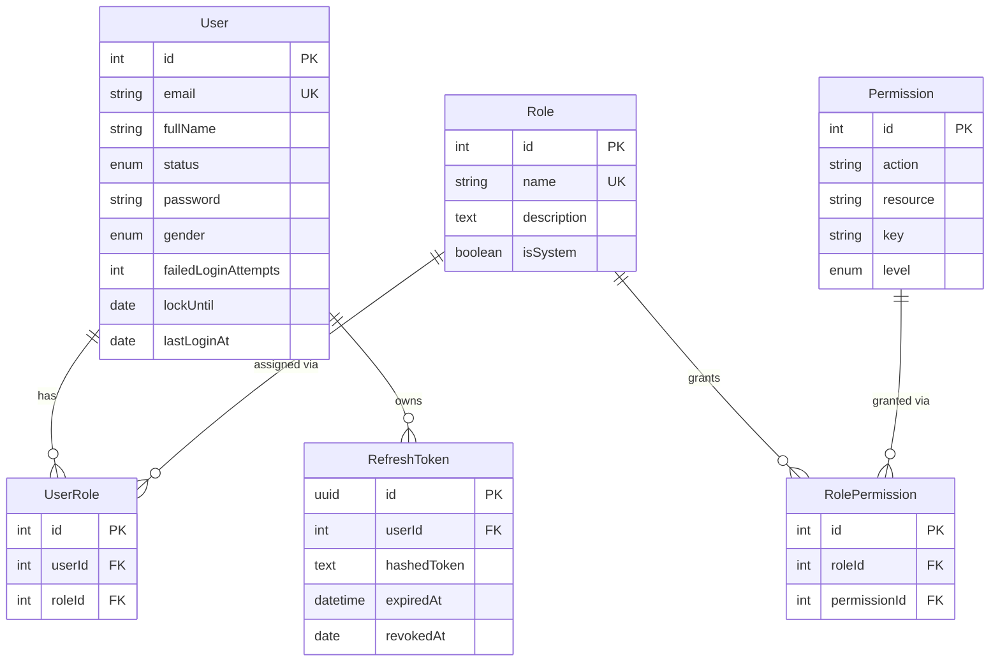
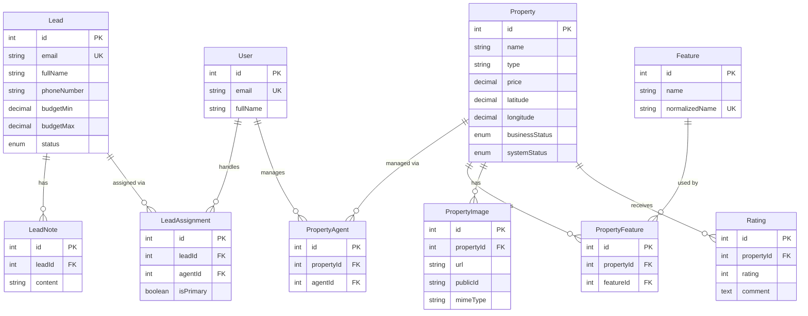
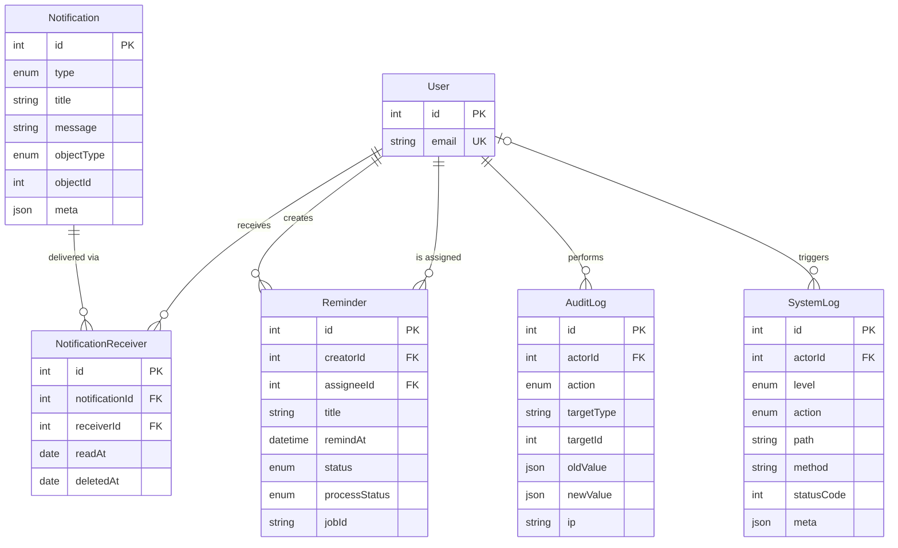
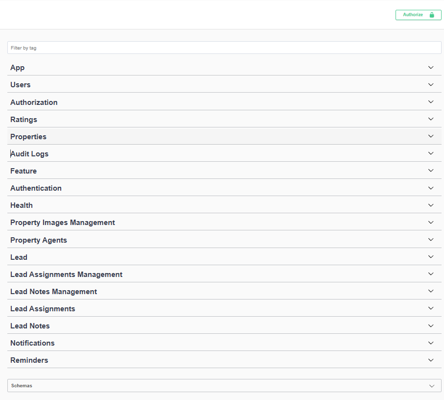
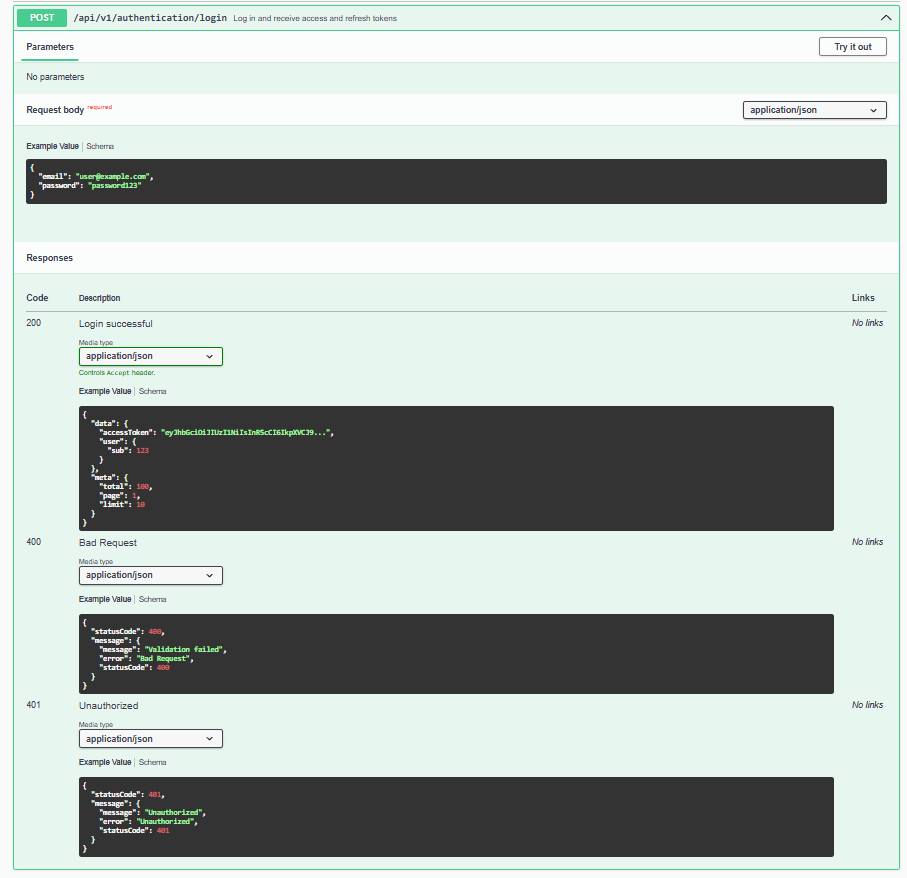
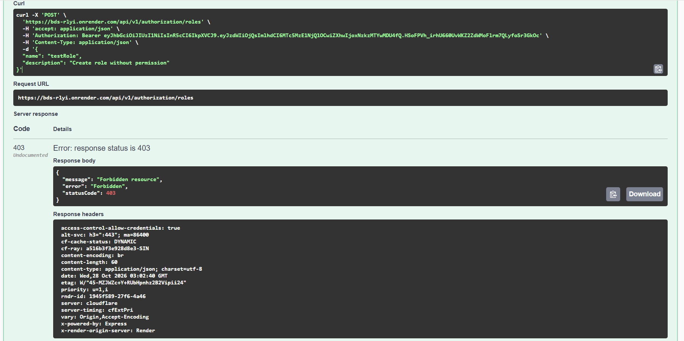

# FirstHome Backend

[](https://github.com/tranductridung/bds/actions/workflows/ci.yml)

A backend system for real estate teams to manage potential customers (leads) and property listings in one place. Administrators configure roles and permissions, while staff and agents handle leads, manage properties and receive reminders and notifications.

Built with **NestJS**, **TypeORM** and **MySQL**, with **JWT** authentication, a **dynamic RBAC system**, Redis-backed rate limiting, background jobs, and system/audit logging.

**Live demo (Swagger UI):** https://bds-rlyi.onrender.com/docs

> The demo is hosted on Render and may take a short while to wake up on the first request.

### Demo accounts

You can log in to the demo with the following accounts:

| Email                  | Password     |
| ---------------------- | ------------ |
| `superadmin@gmail.com` | `superadmin` |
| `admin1@gmail.com`     | `admin`      |
| `staff1@gmail.com`     | `staff`      |

## Table of Contents

- [Features](#features)
- [Tech Stack](#tech-stack)
- [Architecture Highlights](#architecture-highlights)
- [Database Design](#database-design)
- [Getting Started](#getting-started)
- [Environment Variables](#environment-variables)
- [Available Scripts](#available-scripts)
- [Testing](#testing)
- [API Documentation](#api-documentation)
- [Docker](#docker)
- [Project Structure](#project-structure)
- [Deployment & CI/CD](#deployment--cicd)
- [Roadmap](#roadmap)

---

## Features

### Business modules

| Module           | Description                                                                                                              |
| ---------------- | ------------------------------------------------------------------------------------------------------------------------ |
| **Lead**         | Manage potential customers. Sub-modules: **Assignment** (assign leads to staff) and **Note** (notes attached to a lead). |
| **Property**     | Manage real estate listings. Sub-modules: **Agent**, **Image** and **Rating**.                                           |
| **Feature**      | Manage property features that can be attached to properties.                                                             |
| **Reminder**     | Schedule reminders and assign them to users. Due reminders are processed in the background.                              |
| **Notification** | Event-driven notifications using event listeners.                                                                        |

### Technical features

- **Authentication:** JWT access and refresh tokens, email-based account setup and password reset.
- **Authorization:** dynamic RBAC. Roles and permissions are stored in the database (`users`, `roles`, `permissions` and their join tables), so access rules can change without redeploying.
- **Rate limiting:** Redis-backed, configurable via environment variables.
- **Background jobs:** cron jobs with BullMQ (basic setup) for expired-token cleanup and reminders.
- **File uploads:** image storage with Cloudinary.
- **Email:** Nodemailer for account setup and password reset emails.
- **Logging:** separate **system log** and **audit log**.
- **API docs:** Swagger UI at `/docs`.
- **Testing:** unit and e2e tests for authentication and authorization.
- **Containerization:** Dockerfile and Docker Compose included.

## Tech Stack

- **Runtime / Language:** Node.js, TypeScript
- **Framework:** NestJS
- **Database:** MySQL with TypeORM
- **Cache / Queue:** Redis, BullMQ
- **Storage:** Cloudinary
- **Mail:** Nodemailer
- **Docs:** Swagger (`@nestjs/swagger`)
- **Testing:** Jest, Supertest, Testcontainers
- **DevOps:** Docker, Docker Compose, GitHub Actions
- **Deployment:** Render (application), Aiven (MySQL)

## Architecture Highlights

### System overview



Redis is used for both rate limiting and the BullMQ queues.

### Dynamic RBAC

Permissions are not hard-coded into roles. They are stored in the database and linked through join tables (`users_roles` and `roles_permissions`):

```
User ──< UserRole >── Role ──< RolePermission >── Permission
```

| Concept        | Details                                                                                                                                                                                                                                                        |
| -------------- | -------------------------------------------------------------------------------------------------------------------------------------------------------------------------------------------------------------------------------------------------------------- |
| **Permission** | Described by an `action` (e.g. `create`, `read`), a `resource` (e.g. `lead`, `property`), a `key` (`resource:action`) and a `level`. `action` and `resource` are normalized to lowercase. `level` defaults to `BUSINESS` and cannot be changed after creation. |
| **Role**       | Has a unique, lowercase `name` and a description. The `isSystem` flag marks built-in roles.                                                                                                                                                                    |
| **Assignment** | A user can have multiple roles, and a role can have multiple permissions.                                                                                                                                                                                      |

An authorization guard checks the permissions of the current user at request time, so an administrator can create roles and adjust permissions at runtime without redeploying. Roles that are still assigned to users, and permissions that are still granted to roles, cannot be deleted.

Permission keys follow the pattern `resource:action`, for example `lead:create` or `property:image:delete`.

Access control has two layers:

1. **Permission check (RBAC):** the guard verifies that the user's roles include the required permission (for example `lead:update`).
2. **Ownership scope:** users with the `staff` role can only access records assigned to them, while `admin` and `superadmin` can access all records.

Built-in roles and the demo accounts that use them:

| Account                | Role         | What it can do                                                                                                                                                                  |
| ---------------------- | ------------ | ------------------------------------------------------------------------------------------------------------------------------------------------------------------------------- |
| `superadmin@gmail.com` | `superadmin` | All 60 permissions: full CRUD on every resource, including `authorization` (managing roles and permissions).                                                                    |
| `admin1@gmail.com`     | `admin`      | 56 permissions: full CRUD on all business resources (users, properties, leads, notifications, reminders, logs). Cannot manage roles and permissions. Has access to all records. |
| `staff1@gmail.com`     | `staff`      | Same 56 permissions as `admin`, but can only work with records assigned to them (for example, leads assigned to them and properties they are an agent of).                      |

Logging in as `admin1` and `staff1` and comparing the responses (for example a `403 Forbidden` on a record that is not assigned to `staff1`) is the quickest way to see the permission system at work.

See [Database Design](#database-design) for the full schema.

### Logging

- **System log:** application events, warnings and errors.
- **Audit log:** records who did what and when on important resources.

### Background jobs

- **Token cleanup:** periodically removes expired tokens from the database.
- **Reminders:** scheduled reminders processed through a BullMQ queue.

## Database Design

The schema is split into three diagrams for readability. `User` appears in each one because most tables reference it. Only key columns are shown, see the `*.entity.ts` files under `backend/src` for the full definitions.

### Access control and authentication



### Business domain



### Notifications, reminders and logs



### Notes

| Entity                 | Table name                | Notes                                                                                  |
| ---------------------- | ------------------------- | -------------------------------------------------------------------------------------- |
| `UserRole`             | `users_roles`             | Join table between users and roles (unique per pair).                                  |
| `RolePermission`       | `roles_permissions`       | Join table between roles and permissions (unique per pair).                            |
| `PropertyAgent`        | `properties_agents`       | Join table between properties and agents.                                              |
| `PropertyFeature`      | `properties_features`     | Join table between properties and features.                                            |
| `NotificationReceiver` | `notifications_receivers` | One notification can be delivered to many users, each with its own read/deleted state. |

- Join tables use their own `id` and a unique constraint on the pair of foreign keys, instead of a composite primary key.
- Most foreign keys use `ON DELETE RESTRICT`. The exception is `PropertyImage`, which is deleted together with its property (`CASCADE`).
- Refresh tokens are stored as hashes and can be revoked (`revokedAt`).
- `AuditLog` stores `oldValue` and `newValue` as JSON, so changes can be traced without a separate table per resource.
- `SystemLog` has a nullable `actorId` because some events (for example, unauthenticated requests) have no user.

## Getting Started

### Prerequisites

- Node.js 24
- npm
- A running **MySQL** server with an empty database created for the project
- A running **Redis** server
- A Cloudinary account (for image uploads)
- An email account usable with Nodemailer (for sending setup/reset emails)
- Docker (only required to run the e2e tests)

### Installation

```bash
# 1. Clone the repository
git clone https://github.com/tranductridung/bds
cd bds/backend

# 2. Install dependencies
npm install

# 3. Create your environment file
cp .env.example .env
# then fill in the values (see "Environment Variables")

# 4. Seed initial data
npm run seed

# 5. Start the development server
npm run start:dev
```

The API runs at `http://localhost:3000` and Swagger UI at `http://localhost:3000/docs`.

### Database and seeding

The project uses TypeORM with `synchronize` enabled, so tables are created and updated automatically from the entities. There are no migration files. The database itself must already exist (`MYSQL_DATABASE`).

`npm run seed` populates the initial data required to use the system:

- **Permissions:** 15 resources × 4 actions (`create`, `read`, `update`, `delete`) = 60 permissions, with keys such as `lead:create` and `log:audit:read`.
- **Roles:** three system roles. `superadmin` receives all 60 permissions, while `admin` and `staff` receive all permissions except the 4 on the `authorization` resource (56 each).
- **Super admin account:** created from `SUPERADMIN_EMAIL` and `SUPERADMIN_PASSWORD`.

The seed only adds what is missing, so running it again does not create duplicates. It never removes permissions that were granted earlier.

## Environment Variables

Create a `.env` file in `backend/`. Never commit it to version control.

```dotenv
# App
NODE_ENV=development
TRUST_PROXY_HOPS=
SALT=
MAX_AGE=
MAX_TOKEN=

# MySQL
MYSQL_HOST=
MYSQL_PORT=3306
MYSQL_DATABASE=
MYSQL_USERNAME=
MYSQL_ROOT_PASSWORD=

# JWT / tokens
ACCESS_TOKEN=
ACCESS_TOKEN_EXPIRES=
REFRESH_TOKEN=
REFRESH_TOKEN_EXPIRES=
VERIFY_EMAIL_TOKEN=
VERIFY_EMAIL_TOKEN_EXPIRES=
SETUP_PASSWORD_TOKEN=
SETUP_PASSWORD_TOKEN_EXPIRES=

# Super admin (used by the seed script)
SUPERADMIN_EMAIL=
SUPERADMIN_PASSWORD=

# Email (Nodemailer)
EMAIL_USER=
EMAIL_PASSWORD=

# Cloudinary
CLOUDINARY_CLOUD_NAME=
CLOUDINARY_API_KEY=
CLOUDINARY_API_SECRET=

# Redis
REDIS_HOST=localhost
REDIS_PORT=6379

# Rate limiting and queue
RATE_LIMIT_ENABLED=true
REQUEST_LIMIT_DEFAULT=
RATE_LIMIT_TTL_DEFAULT=
QUEUE_WINDOW_MS=
```

| Variable                                                               | Description                                                                                                                                                    |
| ---------------------------------------------------------------------- | -------------------------------------------------------------------------------------------------------------------------------------------------------------- |
| `NODE_ENV`                                                             | Runtime environment (`development`, `production`, `test`).                                                                                                     |
| `TRUST_PROXY_HOPS`                                                     | Number of reverse proxies to trust when reading the client IP (important for rate limiting behind Render).                                                     |
| `SALT`                                                                 | Number of salt rounds used by bcrypt when hashing passwords.                                                                                                   |
| `MAX_AGE`                                                              | Lifetime of the refresh token cookie, in days (default `7`). The application converts it to milliseconds for the cookie's `maxAge`.                            |
| `MAX_TOKEN`                                                            | Maximum number of active refresh tokens per account (that is, how many devices can stay logged in at once).                                                    |
| `MYSQL_HOST`, `MYSQL_PORT`, `MYSQL_DATABASE`                           | MySQL connection target.                                                                                                                                       |
| `MYSQL_USERNAME`, `MYSQL_ROOT_PASSWORD`                                | MySQL username and password used by the application.                                                                                                           |
| `ACCESS_TOKEN`, `ACCESS_TOKEN_EXPIRES`                                 | Secret and lifetime of the JWT access token.                                                                                                                   |
| `REFRESH_TOKEN`, `REFRESH_TOKEN_EXPIRES`                               | Secret and lifetime of the refresh token.                                                                                                                      |
| `VERIFY_EMAIL_TOKEN`, `VERIFY_EMAIL_TOKEN_EXPIRES`                     | Secret and lifetime of the email verification token.                                                                                                           |
| `SETUP_PASSWORD_TOKEN`, `SETUP_PASSWORD_TOKEN_EXPIRES`                 | Secret and lifetime of the token used to set up or reset a password.                                                                                           |
| `SUPERADMIN_EMAIL`, `SUPERADMIN_PASSWORD`                              | Credentials of the super admin account created by `npm run seed`.                                                                                              |
| `EMAIL_USER`, `EMAIL_PASSWORD`                                         | Account used by Nodemailer to send emails (use an app password if your provider requires it).                                                                  |
| `CLOUDINARY_CLOUD_NAME`, `CLOUDINARY_API_KEY`, `CLOUDINARY_API_SECRET` | Cloudinary credentials for image uploads.                                                                                                                      |
| `REDIS_HOST`, `REDIS_PORT`                                             | Redis connection used for rate limiting and BullMQ.                                                                                                            |
| `RATE_LIMIT_ENABLED`                                                   | Turns rate limiting on or off.                                                                                                                                 |
| `REQUEST_LIMIT_DEFAULT`                                                | Default maximum number of requests allowed per window.                                                                                                         |
| `RATE_LIMIT_TTL_DEFAULT`                                               | Default length of the rate limit window, in seconds.                                                                                                           |
| `QUEUE_WINDOW_MS`                                                      | Look-ahead window in milliseconds (for example `3600000` = 1 hour). Every 5 minutes the reminder cron queues the reminders due within this window into BullMQ. |

## Available Scripts

| Command              | Description                                         |
| -------------------- | --------------------------------------------------- |
| `npm run start:dev`  | Start in development mode with hot reload           |
| `npm run start`      | Start the application                               |
| `npm run start:prod` | Run the compiled build (`dist/main`)                |
| `npm run build`      | Compile the project                                 |
| `npm run seed`       | Seed initial data (permissions, roles, super admin) |
| `npm run test`       | Run unit tests                                      |
| `npm run test:cov`   | Run unit tests with coverage                        |
| `npm run test:e2e`   | Run end-to-end tests                                |

## Testing

The project includes unit tests and e2e tests covering **authentication** and **authorization**: token expiry, `401`/`403` responses, and role/permission checks. The suite contains **195 tests** (158 unit, 37 e2e), with **86% line** and **83% branch** coverage on the auth modules.

```bash
# Unit tests
npm run test

# Unit tests with coverage
npm run test:cov

# End-to-end tests
npm run test:e2e
```

> **Note:** the e2e tests use [Testcontainers](https://testcontainers.com/) to start disposable **MySQL and Redis containers** automatically, so **Docker must be running** on your machine. No local MySQL/Redis setup or `.env` database settings are needed for e2e tests, and your development data is not affected. Unit tests do not require Docker.

## API Documentation

Swagger UI is available at `/docs`:

- Local: `http://localhost:3000/docs`
- Demo: https://bds-rlyi.onrender.com/docs

### Screenshots

**API overview**: all endpoints grouped by module in Swagger UI.



**Authentication**: logging in through Swagger UI.



**Authorization**: creating a role without the required permission is rejected.



## Docker

`docker-compose.yaml` (at the repository root) starts the application together with **MySQL** and **Redis**, so you can try the project without installing either of them locally. Run the commands below from the repository root.

```bash
# Build and start all services
docker compose up --build

# Run in the background
docker compose up -d --build

# Stop the services
docker compose down

# Stop and delete the database volume (removes all data)
docker compose down -v
```

> Docker Compose is intended for local use only. The demo is deployed directly on Render, and local development in this project is usually done with MySQL and Redis installed directly on the machine.

## Project Structure

```
.
├── .github/
│   └── workflows/
│       └── ci.yaml        # CI pipeline (GitHub Actions)
├── backend/
│   ├── src/
│   │   ├── authentication/   # Login, token refresh, account setup and password reset
│   │   ├── authorization/    # Roles, permissions and guards (dynamic RBAC)
│   │   ├── cloudinary/       # Image upload integration
│   │   ├── common/           # Shared utilities, transformers and helpers
│   │   ├── config/           # Application configuration and environment variables
│   │   ├── cronjob/          # Scheduled jobs (reminders, expired-token cleanup)
│   │   ├── feature/          # Property features
│   │   ├── health/           # Health check endpoint
│   │   ├── lead/             # Leads: core, assignment, note
│   │   ├── log/              # System log and audit log
│   │   ├── mail/             # Email sending with Nodemailer
│   │   ├── notification/     # Notifications and receivers
│   │   ├── property/         # Properties: agents, images, ratings
│   │   ├── redis/            # Redis connection and rate limiting
│   │   ├── refresh-token/    # Refresh token storage and revocation
│   │   ├── reminder/         # Reminders processed through BullMQ
│   │   ├── seed/             # Seed scripts for permissions, roles and super admin
│   │   ├── user/             # User accounts
│   │   ├── app.module.ts
│   │   └── main.ts
│   ├── test/                 # E2E tests
│   ├── Dockerfile
│   └── package.json
├── images/                   # README screenshots
├── docker-compose.yaml
└── README.md
```

## Deployment & CI/CD

- **Hosting:** [Render](https://render.com) (the app is deployed directly, not as a Docker image).
- **Database:** managed MySQL on [Aiven](https://aiven.io).
- **Redis:** managed Redis (Render Key Value) on [Render](https://render.com), used for rate limiting and BullMQ queues.
- **CI:** [GitHub Actions](https://docs.github.com/en/actions) runs the automated tests on every push and pull request. The e2e tests start their own MySQL and Redis containers via Testcontainers.
- **CD:** Render builds and deploys the application automatically from the repository.

## Roadmap

- [ ] Document the main business flows (lead lifecycle, property listing)
- [ ] Replace `synchronize` with TypeORM migrations
- [ ] Expand test coverage to business modules
- [ ] Run lint (and build) in the CI pipeline before tests
